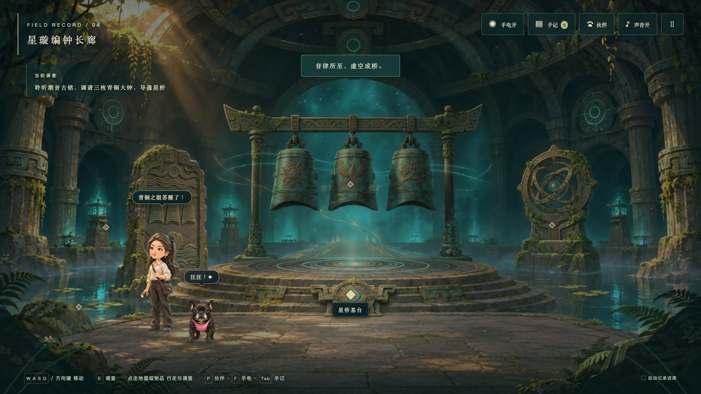
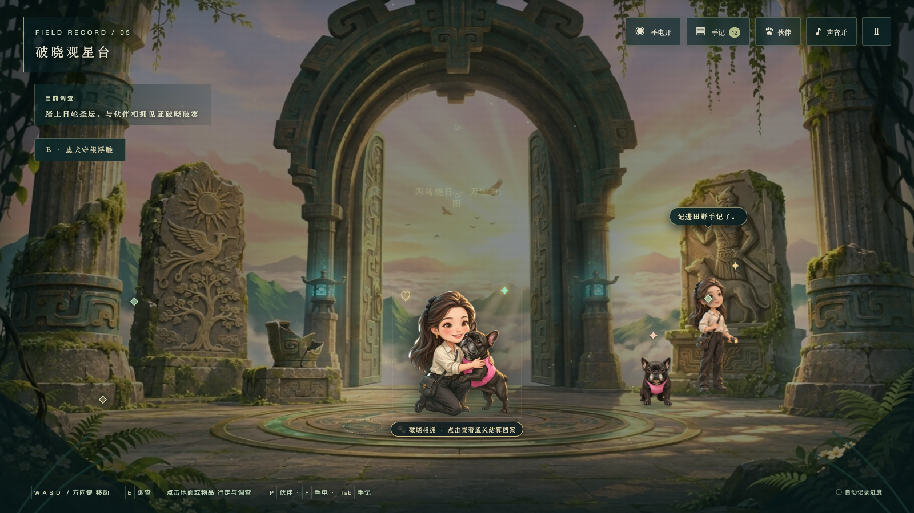
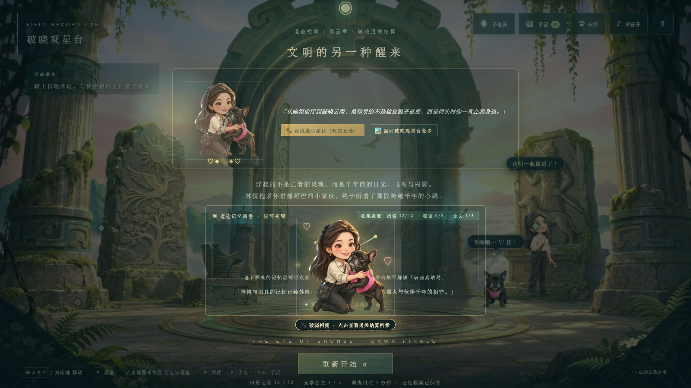

# 古蜀迷踪：青铜之眼 (Bronze Eye)

<div align="center">

-0f4c3a.svg?style=flat-square)


**以古蜀三星堆与金沙青铜文明为艺术灵感的 2.5D Cel-shaded 东方奇幻悬疑解谜冒险游戏（全五章完整通关版）**

*跟随青年考古学者林悦与她的忠诚伙伴粉色胸背小法斗，深入千年前沉寂的地底青铜神殿，唤醒神树、解开编钟星桥，在拂晓晨曦中见证古老守望者的破晓归途。*

</div>

---

## V8 更新 · 2026-11-09

- **双重音律**：第四章保留调音，新增从浑天仪推断的四次叩钟顺序；可重听、清空，错误不清除调音进度。未驻守时不再用亮灯直接标出正确音高。
- **终章九灯**：触碰会翻转本灯及上下左右邻灯，需要规划联动关系。支持当前界面撤回与基于当前盘面的逐步提示；灯态、触碰次数与叩钟记录自动保存，旧存档可读取。已通关旧存档保留结局。
- **温柔陪伴**：右上角「♡ 陪伴」可伸手抚摸、陪它追光、一起休息。远处抚摸时伙伴停下等候；接触后脚底停稳，主角移动可中断亲昵，呼唤可中断追光；连续抚摸有不同轻语。
- **绘景质感**：增加分场景冷暖光束、地面微光、暗角与铜锈纹理，沿用原有绘景与角色资产。未重制人物动作帧，不宣称已达到骨骼动画表现。
- **同心收束**：星阵全亮且现场两份记录收齐后，让伙伴实际坐稳铜环再合上日轮，才出现相拥庆祝。

旧版源码快照在本地 `versions/v7-before-expedition/`（被 Git 忽略，需配合根目录资源使用）；GitHub 中原版由已有提交保留。

### 修改指南

谜题逻辑在 `game.js`：`chimePuzzle` 为调音与四叩，`flipLamps` / `lampRoute` / `dawnPuzzle` 为星灯规则、提示求解与界面。更改星灯初始盘面时，需同时调整 `defaultState` 与 `sanitizeSave` 的回退值，并确认它可解。

宠物逻辑在 `companion.js`：`prepareGreet` 停驻迎候、`pat` 接触与路线重置、`update` 负责优先级和脚底运动。`expedition.css` 管理 V8 新界面与绘景叠层，`drawExpeditionLight` 管理现有画布上的光束。原生打包资源清单在 `tools/build-macos-app.cjs`。

## 游戏实机截图精选

| 第一章 · 青铜神殿前厅 | 第二章 · 神树祭坛 |
|:---:|:---:|
|  |  |
| **第三章 · 青铜之眼密室** | **第四章 · 星璇编钟长廊** |
|  |  |
| **第五章 · 破晓观星台** | **终章结算 · 相拥庆祝大卡** |
|  |  |

---

## 核心玩法与特色系统

### 1. 2.5D Cel-shaded 手绘绘景与多层视差景深
- **全五章画风一致性**：汲取三星堆青铜立人、神树、太阳轮与青铜纵目面具的美学元素，采用柔和水彩绘景搭配青绿与鎏金色调。
- **2.5D 起伏地形与实时倒影**：基于 `terrainLift` 算法实现中央神台抬升与涉水浅滩自然下沉；底层 Canvas 实时渲染角色、水面微波与正弦波切片倒影。
- **双焦点手电聚光与暗场遮罩**：手电光束随角色朝向与观察姿态动态俯仰；关灯时四周沉入深邃暗场，仅泛起生物荧光微茫。

### 2. 法斗伙伴智能随行与双人协作解谜
- **全行为状态机**：沿主角轨迹智能跟随、减速停驻、坐卧打盹、伸懒腰、起步追赶与双向对视轻抚。
- **暗场微光嗅探**：关闭手电（F 键）进入暗处，法斗竖起耳朵循荧光气味引路，发掘 5 件隐藏古蜀秘宝。
- **同心副铜环驻守与共鸣校准**：点击地面青铜同心环，法斗跑位驻守连通音脉，在机关界面开启「🐾 伙伴共鸣校准」双人共鸣提示。
- **情境微小剧场与头顶轻语气泡**：观察水镜惊跳摇尾、面对巨面勇敢护主；主宠头顶半透明气泡实时反馈探索对语。

### 3. 拟物青铜机关与五声编钟音律
- **拟物青铜棘轮（Bronze Wheel）**：可机械顺时针旋转的 SVG 青铜圆盘、内外刻度轮齿与双目星宿光点盘。
- **古蜀五音律调谐**：第四章编钟长廊依据古蜀古铭，将日钟调至宫音（3）、鸟钟调至羽音（5）、枝钟调至商音（2），导通虚空星桥。
- **神树能量渐进点亮与全息奇观**：神树三铜枝随机关调谐分段点亮；终章唤醒时金色太阳轮旋转、镜池金波荡漾、12 只金鸟振翅升空。

### 4. 破晓终章与主宠相拥庆祝交互
- **高保真相拥立绘**：第五章观星台中央独立呈现林悦与法斗相拥的 Cel-shaded 高清精灵图，自带柔和光晕与悬浮光屑。
- **多维度胜利结算**：点击相拥精灵或圣坛唤出 `#endingHugShowcase` 终章大卡，点击「🐾 再抱一下」触发爱心与梅花爪印粒子，亦可点击「✦ 漫步破晓天台」退出结算面板，在朝阳云海中自由漫步。

### 5. Web Audio 纯代码合成声景与手柄全操控
- **原生混响声景**：无外部音频文件依赖，以纯代码合成编钟泛音列、石殿混响、带通洞穴风声与石板/青铜/浅滩三材质动态脚步声。
- **Gamepad API 完整适配**：支持 Xbox / PlayStation DualSense / Switch Pro 等标准蓝牙/USB 手柄，双摇杆移动与光斑瞄准，解谜共鸣双马达震动回馈。

---

## 游戏章节与剧情一览

| 章节 | 场景名称 | 核心目标 | 核心谜题 / 机制 |
|:---:|:---|:---|:---|
| **Prologue / 01** | **青铜神殿前厅** | 调查石碑、残器与壁画，叩响青铜古门 | 青铜门环棘轮符号排列（太阳 → 飞鸟 → 树枝） |
| **Chapter 02** | **神树祭坛** | 读取计数铭版，调谐神树三处机关节律 | 太阳轮（3）、飞鸟轮（2）、神木轮（4），神树铜枝渐进点亮 |
| **Chapter 03** | **青铜之眼密室** | 结合考古手记，唤醒沉睡千年的青铜之眼 | 逆向旋回符号（树枝 → 飞鸟 → 太阳）与双目承载（左目3·右目4） |
| **Chapter 04** | **星璇编钟长廊** | 同时解读音高与叩击先后 | 三钟调谐 + 归巢四叩，静音时可读叩击记录 |
| **Chapter 05** | **破晓观星台** | 调查星阵规则，与伙伴共同开启日轮 | 九灯十字联动、撤回、动态提示、同心环驻守、相拥结局 |

---

## 运行方式

### 方式一：原生 macOS 应用程序（推荐，双击即玩）

本项目已使用 Cocoa + `WKWebView` 原生编译打包为独立的 macOS 应用程序 **`古蜀迷踪：青铜之眼.app`**：
1. 在 Finder 中直接双击 **`古蜀迷踪：青铜之眼.app`** 即可在独立高清窗口中运行，无需开启终端或本地服务。
2. 支持快捷键：
   - `Ctrl + Cmd + F`：全屏 / 退出全屏
   - `Cmd + 1` / `Cmd + 2`：标准窗口尺寸切换（1280×720 / 1600×900）
   - `Cmd + R`：重新载入
   - `Cmd + Shift + Backspace`：重置本地存档
   - `Cmd + Q`：退出游戏
3. 存档自动桥接至 macOS 原生 `UserDefaults`（`com.bronzeeye.game`），支持直接将 App 移动至 `/Applications` 文件夹。

### 方式二：双击快捷脚本运行

macOS 用户可直接在项目根目录下双击运行 **`启动游戏.command`**，脚本将自动拉起本地轻量 HTTP 服务器并在默认浏览器中全屏开启游戏。

### 方式三：终端轻量启动

游戏采用纯原生前端技术栈构建，**零外部框架、零编译打包依赖**：

```bash
# 进入游戏根目录
cd bronze-eye

# 使用 Python 启动极简 HTTP 服务
python3 -m http.server 5173 --bind 127.0.0.1
```

在 Safari、Chrome、Edge 或 Firefox 浏览器中访问：<http://127.0.0.1:5173> 即可。

### 方式四：GitHub Pages 静态托管

由于游戏为纯静态 Web 技术（HTML/CSS/JS/Canvas/WebAudio），直接开启本仓库的 **Settings → Pages**，将分支指定为 `main`、路径指定为 `/ (root)`，即可作为免安装在线网页版直接对外分享游玩！

---

## 操作指南

### ⌨️ 键盘与鼠标

| 按键 / 操作 | 功能描述 |
|:---|:---|
| **W / A / S / D** 或 **方向键** | 控制林悦在可行走区域内移动（带真实平滑边界约束） |
| **鼠标左键点击地面** | 触发青铜步印水波涟漪，林悦与法斗自动寻径走近 |
| **鼠标左键点击调查点** | 自动走近并展开物品考据手记或机关解谜界面 |
| **E 键** | 走近可互动热点时快捷触发调查 |
| **Tab 键** | 随时展开/收起《古蜀青铜拓片与考古手记》（双页书卷式） |
| **F 键** | 开关手电筒（关闭手电筒即可激活法斗「暗场荧光嗅探」模式） |
| **P 键** | 呼唤法斗伙伴；站在青铜同心环旁按 P 可让法斗驻守导通共鸣 |
| **M 键** | 切换游戏全局静音 |
| **Esc 键** | 关闭当前弹窗或打开游戏暂停菜单（暂停时完全冻结画面与动画计时） |

### 🎮 手柄操控（Gamepad）

连接 Xbox / PlayStation / Switch Pro 等通用手柄后，界面左下方将实时点亮 **`🎮 手柄就绪`**：
- **左摇杆 / 十字键**：平滑移动角色
- **右摇杆**：平滑移动手电聚光照射光斑
- **A 键**：调查 / 确定
- **B 键**：关闭弹窗 / 返回
- **X 键**：轻声呼唤法斗
- **Y 键**：开关手电筒
- **LB 键**：指挥法斗驻守 / 离开副铜环
- **RB 键**：翻阅田野手记
- **Start 键**：暂停游戏
- **双马达震动**：解谜共鸣校准、机关解开与亲抚伙伴时提供真实触感回馈

---

## 项目工程结构

```text
bronze-eye/
├── index.html                    # 游戏主入口与 DOM 结构
├── style.css                     # 核心舞台、布局与基础控件样式
├── expedition.css               # V8 星灯、陪伴面板、铜锈纹理与分场景光层
├── painterly.css                 # 2.5D 绘景、青铜棘轮、暗场遮罩与相拥终章特效
├── game.js                       # 场景管线、五章解谜逻辑、Web Audio 合成音与存档
├── hero.js / hero.css            # 林悦 16 帧手绘序列帧、表情、接地阴影与环境色
├── companion.js / companion.css  # 法斗 24 帧动作表、跟随寻路、微光嗅探与情境小剧场
├── assets/                       # 游戏核心多媒体资产
│   ├── painterly/                # 5 大关卡高清 WebP 背景与遮罩图层
│   ├── hero/                     # 人物动作帧、归一化数据及相拥庆祝 WebP
│   └── companion/                # 法斗动作帧图集与基线清单
├── tools/                        # 工具与自动化测试套件
│   ├── verify-v7-chapters.cjs    # V7 全五章 30 项端到端全自动通关测试
│   ├── build-macos-app.cjs       # 原生 macOS .app 编译与代码签名构建脚本
│   └── macos-app/main.swift      # Cocoa + WKWebView 原生窗口与存档桥接源码
├── artifacts/                    # 实机截图证据与结构化测试日志
│   └── v5/screenshots/           # 包含全五章、相拥大卡及拓片实机截图
├── 古蜀迷踪：青铜之眼.app         # 已签名、可双击独立运行的原生 macOS 应用程序
├── 启动游戏.command               # 一键本地运行脚本
├── ASSETS.md                     # 美术资产来源、生成提示词与权利说明
├── PROJECT_STATE.md              # 研发演进历史与全功能验收台账
└── WALKTHROUGH.md                # 游戏通关解法与谜题线索备忘
```

---

## 自动化测试与质量验收

当前 V8 的完整流程测试：

```bash
npm run test:expedition
node tools/test-v8-interactions.cjs
# 伙伴旧版回归需先启动本地 5173 服务
COMPANION_ARTIFACT_DIR=artifacts/v8 npm run test:companion
```

测试使用本机已有 Chromium，`BROWSER_PATH` 可指定浏览器可执行文件。结果保存在 `artifacts/v8/`；旧版测试和截图保留，`verify-v7-chapters.cjs` 仅记录历史玩法，已不适用于新增的星阵与叩钟流程。原生 Safari、iOS、真实手柄与长时间帧率仍需实机验收。

---

## 许可证与致谢

- **开源协议**：本项目基于 [MIT License](LICENSE) 开源。
- **文化致谢**：感谢古蜀三星堆与金沙遗址考古工作者为人类文明揭开的璀璨历史瑰宝。
- **免责声明**：本作所有剧情、谜题与角色设定纯属艺术虚构，以向古蜀文明致敬。

## 独立小游戏：小毛的准时下班

[打开准时下班](准时下班/index.html) · [项目说明](准时下班/README.md) · [V5坐班掩护效果](准时下班/artifacts/v5/index.html)

保留项目人物并换上职业装，在细致的日落办公室里避开老板和同事，完成日报、取工牌、最后回自己的工位拿包，争取18:00准点离开。支持闪身步、哆嗦毛、坐下打字免打扰及打印/咖啡掩护；四种通勤包对应不同负担。纯HTML/CSS/JS，可离线运行，成绩保存在本地。2026-11-12 V5通过104项检查，原生Safari/iOS尚待实机验收。
